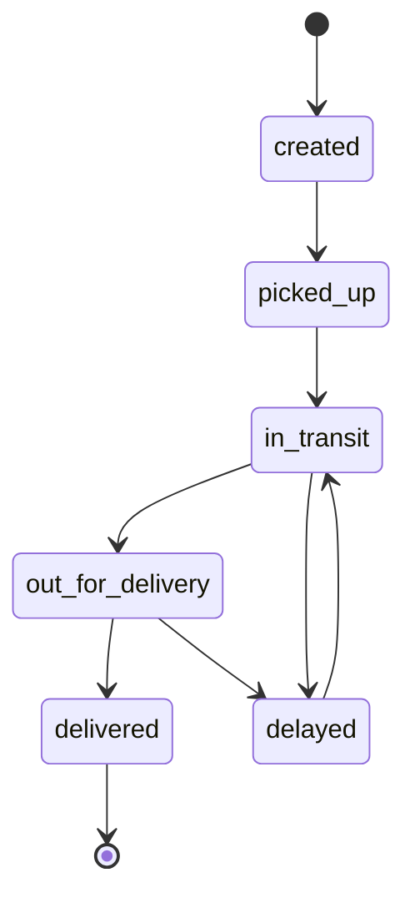

# HTTP API

Base path: `/api`. JSON requests and responses. Operator endpoints require `Authorization: Bearer <operator-token>`. Do not put this token in query strings or commit it in scripts.

| Method and path                              | Access                    | Result                                                     |
| -------------------------------------------- | ------------------------- | ---------------------------------------------------------- |
| `GET /healthz`                               | Internal health check     | Liveness, no DB dependency.                                |
| `GET /readyz`                                | Internal API health check | 200 when DB responds; 503 otherwise.                       |
| `GET /api/shipments/:trackingNumber`         | Public                    | Shipment and ordered events; excludes operator reference.  |
| `GET /api/shipments`                         | Operator                  | Latest 100 shipments, including references.                |
| `POST /api/shipments`                        | Operator                  | Create shipment + initial event; returns 201 and Location. |
| `POST /api/shipments/:trackingNumber/events` | Operator                  | Append valid transition atomically; returns 201.           |

The ALB routes `/api` to the API and other paths to Nginx. `/healthz` on the public website checks Nginx; the ALB API target group checks the API's `/readyz` directly. Do not mistake website liveness for database readiness.

Create payload:

```json
{
  "origin": "Berlin",
  "destination": "Munich",
  "service": "express",
  "reference": "Synthetic example"
}
```

`origin` and `destination` are 2–80 character city names. `service` is `standard` or `express`; `reference` is optional and at most 80 characters. Unknown fields are rejected.

Scan payload:

```json
{ "status": "picked_up", "location": "Berlin", "expectedVersion": 1 }
```



On `409`, refresh the current shipment and decide whether another scan is still appropriate. Never blindly retry a status update. Shipment creation has no idempotency key; check whether a submission succeeded before repeating a timed-out request.

Error codes: 400 invalid input, 401 missing/incorrect operator token, 404 missing shipment/route, 409 stale version or disallowed transition, 413 body too large, 429 rate limited, 500 generic server error. Error responses include a request ID. The API rate limit is 120 requests per minute per client address per replica; health probes bypass it.
